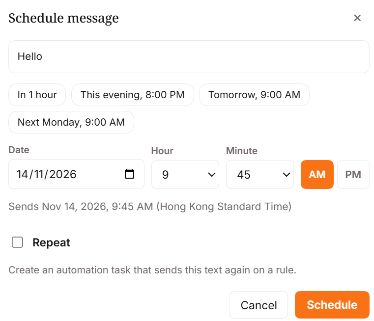

# dsh-scheduled-message

[](https://www.dsh.so/artifact/dsh-scheduled-message/?ref=badge)

Schedule the message you are already writing in the DSH composer — text, images and files — to be
delivered later by the **Host**. Because the timer and the store live in the Host, closing the tab or
the window does not cancel anything, and a message whose time passed while DSH was closed is queued at
the next start and marked **accepted late**.

A **Scheduled** tab in the left sidebar then lists every scheduled message across all conversations,
in time order, and lets you edit the time, the text, the attachments and the destination, move a
message to another conversation (or to a new one), send it now, delete it, or retry a failed
delivery. Normal sending is untouched: Enter, Shift+Enter, Ctrl/Cmd+Enter and the Send button keep
exactly their current meaning.



## What you get

| Surface | Behaviour |
|---|---|
| **Schedule** button | Orange pill beside Send in the composer tool row. Disabled while the draft is empty or the composer is busy. |
| **Alt+Enter** (Option+Enter on macOS) | Opens the same dialog. Registered as an editable-region shortcut, editable in Settings › Shortcuts. |
| **Dialog** | Date, hour 1–12, minute, AM/PM, quick picks, a destination that starts on **New conversation** (one click back to **This conversation**), a "Sends …" summary, and an optional **Repeat** row. Backdrop/Escape close, focus returns to the composer. |
| **Scheduled tab** | Every scheduled message, across every conversation, grouped by day. Hover actions: **Send now**, **Edit**, **Delete**. Failed rows show the reason plus **Retry**. |
| **Editor** | Change the time, the text, images and files, and the destination — an existing conversation or a new one that is created when the message is due. Saves detect concurrent edits instead of overwriting them. |
| **Strip** | Above the composer: `2 scheduled · next Fri, 14 Nov, 9:00 am`, expandable to rows with **Send now**, **Change time**, **Cancel**, **Retry**, and a **View all** link to the tab. |
| **Status** | A settled record reads **Accepted**. DSH reports when it queues a prompt, not when the turn that carries it starts or finishes, so nothing claims the message was sent. Two messages to one conversation close together say so inline. |
| **Repeat** | Creates a task in DSH's own Automation service and opens its task page. Blocked when the draft has images or files. |
| **Peak-price hint** | When the chosen time lands in DeepSeek's peak window and the session runs a DeepSeek model, the dialog adds one orange line naming the window in your own time zone. Weekends and off-peak hours are half price. |
| **Phone** | Bottom sheet under 640 px, 44 px targets, 16 px inputs (no zoom-on-focus), safe-area padding. |
| **Theme** | Host tokens for every surface and text colour; the accent orange is the only literal colour. English and Chinese dictionaries ship complete. |

## The Scheduled tab

The tab sits directly under **Automation tasks** in the sidebar and opens as a full page: one centred
column, a count under the title, then day groups — **Today**, **Tomorrow**, the weekday for the next
few days, then a full date. Grouping uses your browser zone, not the Host's.

- **Rows** show the send time, the message preview, the destination (`workspace › conversation`) and
  attachment chips — image thumbnails and file names with sizes. Hovering (or tapping, on a phone)
  reveals **Send now**, **Edit** and **Delete**; clicking the row opens the editor.
- **Failed** rows carry a red rule and the delivery reason, with **Retry** and **Edit**.
- **Settled** messages stay for 24 hours in a collapsed, dimmed group and read **Accepted** — or
  **accepted late** for one queued after its instant. The row never claims the turn finished.
- **Repeating** messages are listed read-only with a link to **Automation tasks** — they belong to
  DSH's Automation service, which delivers text only.
- **All / This workspace**: when a conversation is open, one small control narrows the list to that
  workspace. Without that mapping the tab simply shows everything.

### Editing one message

The editor opens as a side sheet on wide screens (the list stays visible), a centred dialog in the
middle, and a full-height bottom sheet on a phone. Top to bottom: **When** (the same quick picks,
date and 12-hour clock as the dialog, with the "Sends …" summary and the peak-price note), **Message**
(an auto-growing textarea), **Attachments** (chips with a thumbnail or file glyph, size and ×; add
files, drop them on the editor, or paste an image), **Send to** (a searchable picker of workspaces and
their conversations, plus **+ New conversation** per workspace), and the footer: **Delete** on the
left, **Cancel** and **Save** on the right.

Save sends only what changed and carries the record's `updatedAt`. If the message changed in another
tab meanwhile, the save is refused: your text stays, the record is reloaded, and a notice asks you to
review and save again. If the message was sent while you were editing, the editor closes and tells you
so.

A message can be moved to another workspace's conversation — its attachments travel with it, because
stored attachments are not tied to a conversation — or to **a conversation that does not exist yet**,
which is created in the chosen workspace when the message is due. That creation is written to the
record before the message is sent, so a crash cannot produce two conversations or two copies.

The list refreshes when the panel opens, after every action, on window focus, when the tab becomes
visible again, and once shortly after the next due time. There is no interval polling.

## Install

Published on npm as `dsh-scheduled-message`. The package is a normal DSH plugin bundle: a Host half
(`index.js`), a browser half (`client.js`), and one patch entry.

```sh
dsh plugin --profile <profile> add dsh-scheduled-message
```

Replace `<profile>` with the profile your host runs — `web` for a plain `dsh web`. DSH Desktop keeps
its own profile, so install there from **Settings → Plugins** instead of the command line.

The command forwards to pnpm in the profile directory and, because the package declares `dsh.bundle`,
adds it to `dsh.profile.bundles` as well. Then restart DSH.

The market card does the same thing in one click: **Plugins** → **Discover**, search *scheduled
message*.

Needs DSH `0.2.2-rc.2` or newer (`engines.dsh`).

### Without a package manager

Put the folder where the profile can resolve it, list it in that profile's `package.json`, and
restart:

```sh
cp -r dsh-scheduled-message ~/.dsh/profiles/<profile>/node_modules/dsh-scheduled-message
```

```jsonc
"dependencies": { "dsh-scheduled-message": "file:./node_modules/dsh-scheduled-message" },
"dsh": { "profile": { "bundles": [ …, "dsh-scheduled-message" ] } }
```

With the plugin manager available, `install_bundle` with this directory as the target does the same
thing and reports `application: applied`.

Registering the row directly, without touching `dsh.profile.bundles`, also works — the bundle ships
`cordis.patch.yml`:

```yaml
- insert:
    - id: dsh-scheduled-message
      name: dsh-scheduled-message
```

### Upgrading from 0.2.x

Nothing to do. The stored records are version 1; the plugin writes version 2 and reads both, so
messages scheduled before the upgrade still deliver. Before the first 0.3.0 run the v1 storage unit
was copied to `.backup/` in this repository if you want a copy of the old file.

## Using it

1. Type the message and attach anything you want.
2. Press **Alt+Enter**, or click **Schedule**.
3. Pick a date and a time on the 12-hour clock, or use a quick pick.
4. Press **Schedule**. The draft and its attachments are cleared and the message appears in the strip.
5. Close the tab whenever you like. Delivery is the Host's job.
6. Open **Scheduled** in the sidebar to see everything that is waiting, change it, or move it.

Tick **Repeat** instead to create an Automation task: daily, weekdays, weekly on the chosen weekday,
or monthly on the chosen day. Monthly rules on the 29th–31st skip months that are too short.

## What it does not do

- **No repeating messages with attachments.** The Automation service delivers text only, so the UI
  and the Host validator both refuse that combination. Repeating tasks are edited in Automation tasks,
  never in the Scheduled tab.
- **No auto-retry.** A failed delivery is reported with its reason; **Retry** is a user action.
- **No polling.** The strip and the tab refresh on mount, after an action, on window focus, on
  becoming visible, and once shortly after the next due time.
- **No invented conversation names.** DSH's session list does not carry a title, so a destination
  shows the workspace name and a short conversation id unless the build exposes a title.
- **No attachment deletion.** Removing a chip drops the reference to the stored file; the bytes
  follow DSH's own attachment retention, because this build has no delete API.
- **No claim that a message was delivered.** DSH accepts a prompt into a conversation's queue and
  says nothing about the turn behind it, so a settled record reads **Accepted** rather than Sent, and
  no row ever says Running or Completed.
- **No new conversation with attached files.** A staged file belongs to the conversation that uploaded
  it, so a message addressed to a new conversation is refused at create time; send it to this
  conversation instead.
- **No cross-zone surprise.** The browser's IANA zone is captured at create time and only used for
  display and for the 12-hour reading; the Host stores one absolute instant.
- **Disabling the plugin does not delete anything.** Pending records stay in storage and resume when
  the plugin is enabled again.

## Layout

```
index.js              Host half: durable store, thirteen /api routes, timer, delivery
client.js             browser bundle (generated — see scripts/build-client.mjs)
client.src.js         browser half source: composer button, dialog, strip, Scheduled tab, editor
lib/core.js           dependency-free shared logic: 12-hour clock, zone resolution, validation,
                      record schema v1→v2 migration, day grouping, RRULE text, retention
locale/en.json        English dictionary
locale/zh.json        Chinese dictionary
scripts/build-client.mjs   inlines lib/core.js + locale/*.json into client.js
scripts/check.mjs     static gates (bundle freshness, locale coverage, exports, registrations)
test/support/host-smoke.mjs     end-to-end Host test against in-memory services
test/*.test.mjs       node --test suites
docs/DETAIL.md        design notes, API evidence, and what is still unverified
```

## Development

```sh
npm run build     # regenerate client.js after editing client.src.js, lib/core.js or locale/*.json
npm test          # unit + bundle + Host smoke tests
npm run check     # static gates
```

## Status

`0.4.0`. 62 core tests, 24 client tests, one Host wrapper running 239 assertions, the static gates
and the standalone Host smoke test (239 assertions) all pass.

0.4.0 makes the destination explicit and the status honest. The compose dialog now names where the
message goes: **New conversation** by default — opened at send time, exactly once, reused on retry —
or **This conversation**, one click away, which sends the same request an older client sends. A second
message to one conversation within two minutes is called out inline instead of surprising you at the
due instant. A settled record reads **Accepted**, because the queue is the last thing DSH tells this
plugin about: it never learns when the turn behind a message starts or ends. The stored schema and
every status value are unchanged, so records written by 0.3.0/0.3.1 keep working; the default
destination is the one behaviour that changed, and *This conversation* is one click away.

0.3.0 adds the **Scheduled** sidebar tab and its editor: every scheduled message in one list, with
the time, the text, the attachments and the destination editable, moves between conversations,
delivery into a newly created conversation, and read-only rows for repeating tasks. With it the
record schema moved to version 2 — the domain declares `compatibleVersions: [1]`, so records written
by 0.2.x still open and still deliver. 0.2.x added the DeepSeek peak-price hint; 0.1.1 fixed the
composer button so it enables as soon as you type.

0.3.1 fixes a blank panel: opening a scheduled message crashed the tab before its record had
loaded, because the editor tried to format a send time it did not have yet. `describeDue` now
answers an empty string instead of throwing, the editor only writes the summary once it has a real
instant, and `test/client.test.mjs` renders the editor's first paint so it cannot come back.

Verified: the two project gates, the Host end-to-end smoke test (including a v1 record opening
under the v2 schema and a `kind:'new'` delivery that creates exactly one conversation), the
bundle-freshness and dictionary-parity gates, the panel's two slot registrations structurally,
and the tab itself rendering in the live desktop GUI. Still a human look away: the editor's
sheet/dialog/bottom-sheet layouts, the destination picker against a real workspace list, and the
phone layout. Details are in [`docs/DETAIL.md`](docs/DETAIL.md#9-v2).
